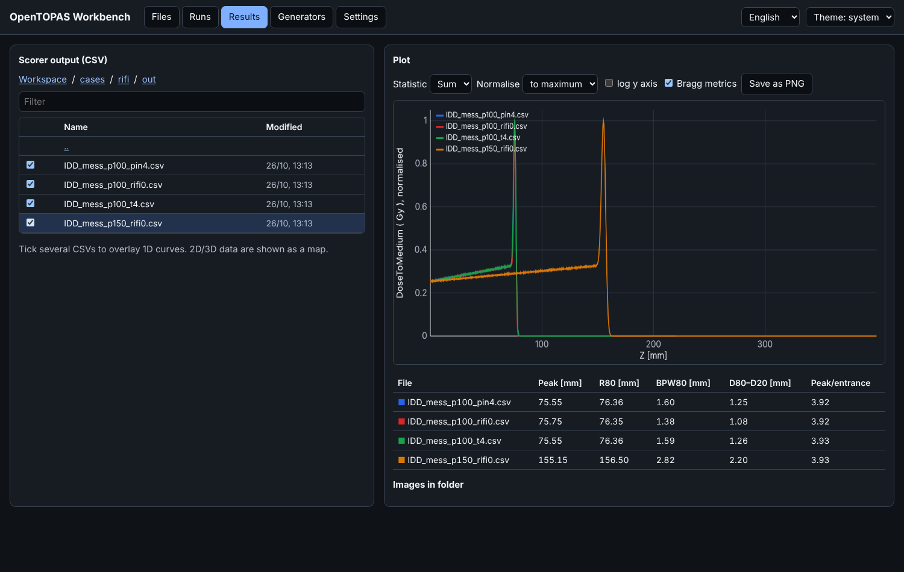
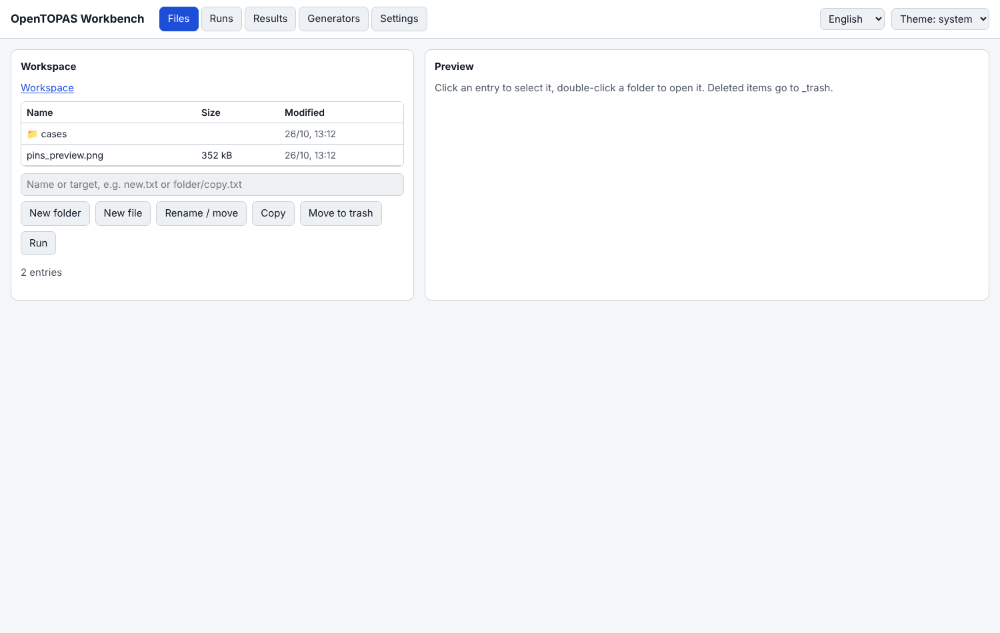
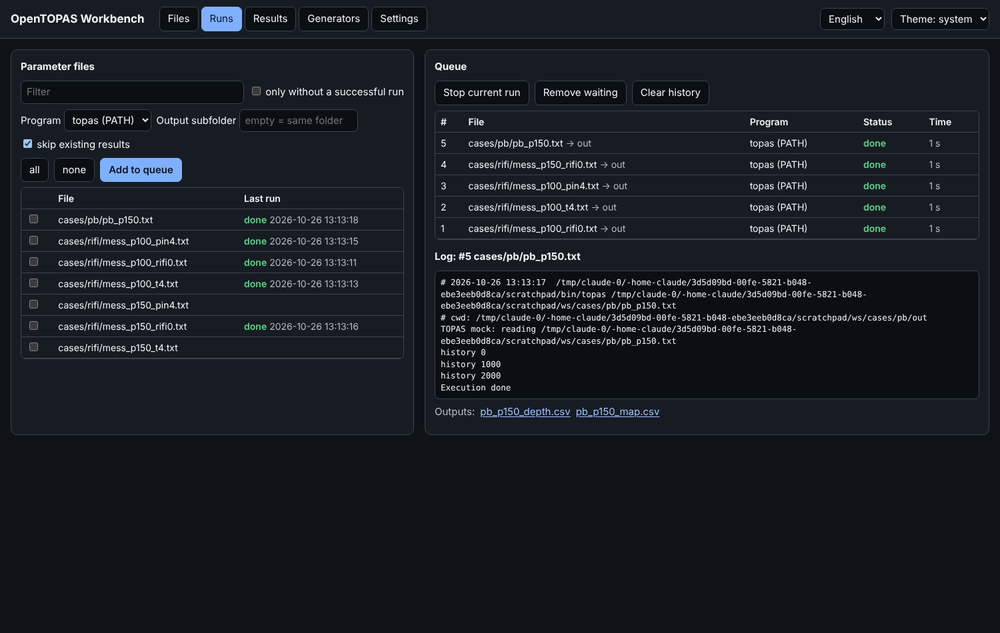
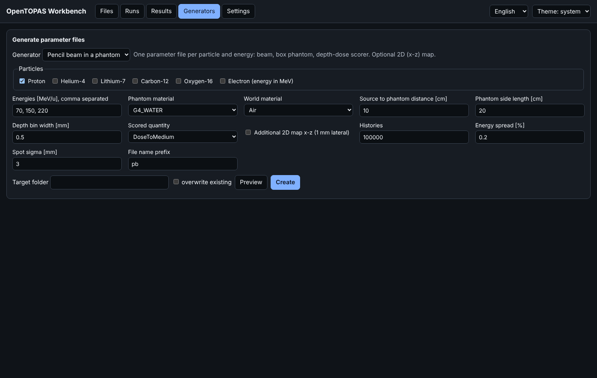
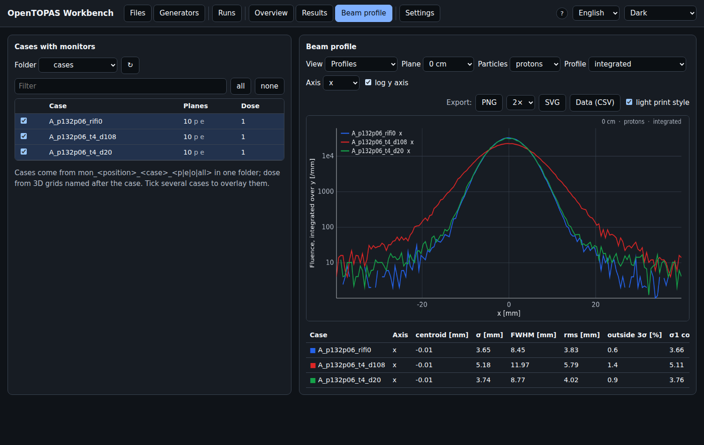
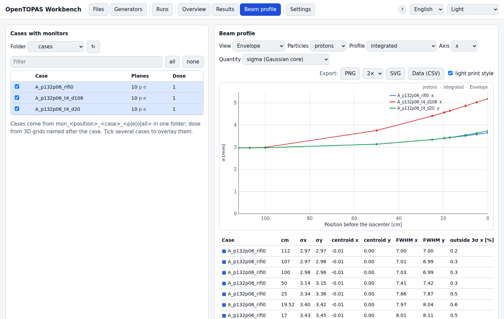
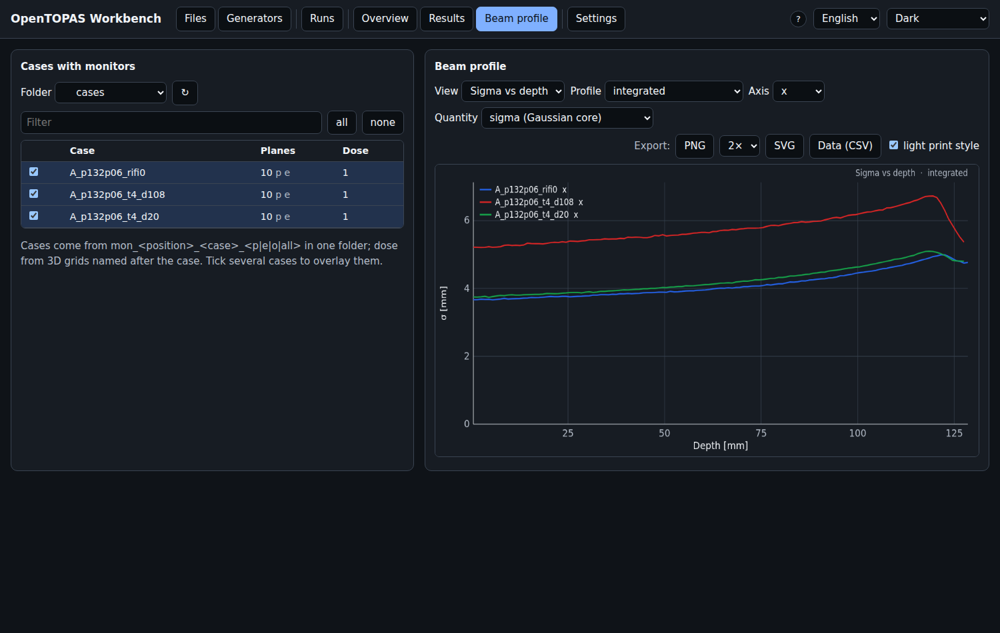

# OpenTOPAS Workbench

A local web UI for [OpenTOPAS](https://github.com/OpenTOPAS/OpenTOPAS) and TOPAS 3.9: edit parameter files, run them in a queue, and plot scorer output. Pure Python standard library, no dependencies.



> Community project, not affiliated with the TOPAS collaboration or TOPAS MC Inc.

## Features

- **Files**: browse, edit, rename, copy, and trash files in a workspace folder. The editor highlights TOPAS syntax, checks it while you type (missing type prefix, unquoted strings, missing units, vector counts, missing `includeFile` targets), and suggests parameter names.
- **Runs**: queue parameter files for one or more TOPAS installations. Progress bar with remaining time, live log with highlighted errors, stop button, optional output subfolder. Existing results are detected, also when the cases were run outside the workbench.
- **Overview**: every result in the workspace in one table, filtered by particle, energy, folder, or file-name tags. Beam data come from the parameter file that wrote the output. R80, BPW80, deviations to a reference (for example the case without filter), a Bragg-Kleeman range check, your own formula columns, CSV export, and an image gallery with full-screen view.
- **Results**: plot TOPAS CSV scorer output and measured curves (PTW `.mcc`, IBA `.asc`, column files). Overlay curves with normalisation, log axis, drag zoom, hover read-out, and difference or ratio to a reference. Bragg peak metrics (R80, BPW80, D80-D20, ΔR80, filter BPW80). 2D and 3D binnings show as a heat map.
- **Beam profile**: the monitor planes and 3D dose grids of a folder. x and y profiles (integrated or as a cut through the centroid, linear or logarithmic for the halo) and the 2D map per plane; the envelope, sigma, FWHM, centroid, or halo share along the beam line for several cases at once; energy spectra; lateral dose profiles at a depth picked with a slider, and sigma against depth. Every profile gets a Gaussian core fit (sigma, mean), FWHM, rms, the share outside 3 sigma, and a double Gaussian (core and halo sigma, halo share) where the profile has a halo.
- **Export**: plots as PNG or SVG in a print style, plotted data as CSV, results and images as ZIP. Plot settings can be saved as named views.
- **Variations**: copy a parameter file with one parameter set to a list of values; output names get a matching suffix.
- **Notifications and keep-awake**: browser or Windows notification when runs fail or the queue is done; system sleep is blocked while runs are queued, optionally the display stays on as well (see [Long runs on Windows laptops](#long-runs-on-windows-laptops)).
- **Generators**: plugins that write parameter sets from a form.
  - `pencil_beam`: any particle from protons to oxygen, an energy list, phantom material, depth dose, and an optional 2D map. Sets `EMRangeMax` for light ions above the default table range.
  - `ripple_filter`: depth-dose studies with 1D, crossed, and 2D ripple filters (pins and pyramids written as binary STL, plus 1D ridges with the same thickness distribution as a 2D filter).
  - Both can add beam profile monitors: thin scoring planes in a parallel world, so they do not change the physics, at a list of positions (cm before the isocenter) or before and after every component. Each plane scores a 2D fluence map (default 0.5 mm bins over ±40 mm), optionally split into protons, electrons, and other particles, and an energy spectrum. Outputs are named `mon_<position>_<case>_<p|e|o|all>.bin` and `mon_<position>s_<case>_<spec|espec>.csv`, with `p` for the decimal point (`19p52`).
- **Navigation**: tabs follow the workflow from generating cases to comparing results; "plot results" links in Runs, the queue, and the Overview lead straight to the curves. The address keeps the tab, the open file, and the plotted curves, so Back, Forward, and bookmarks work. Press `?` for the keyboard shortcuts (`1` to `7` switch tabs, `/` focuses the filter).
- **Large workspaces**: hundreds of cases and big non-TOPAS files (matRad `.mat`, DICOM) are fine. Only parameter files and scorer output are read, parsed facts are cached, and the lists refresh in the background.
- English and German UI, light and dark theme.

| Files | Runs | Generators |
|---|---|---|
|  |  |  |

| Beam profile: profiles (log) | Beam profile: envelope | Beam profile: sigma against depth |
|---|---|---|
|  |  |  |

## Requirements

- Python 3.9 or later
- OpenTOPAS or TOPAS 3.9 on Linux, macOS, or Windows via WSL

## Install and start

```
pip install git+https://github.com/Robing98/opentopas-workbench
opentopas-workbench --workspace PATH_TO_YOUR_CASES
```

Without installing, from a clone of this repository:

```
./workbench.sh PATH_TO_YOUR_CASES
```

On Windows with TOPAS in WSL, run `workbench.bat PATH_TO_YOUR_CASES` from a Command Prompt, or double-click it. Without a folder, both launchers use a folder named `workspace` next to them if it exists (it is in `.gitignore`), otherwise the current folder.

The browser opens `http://localhost:8765`. Options: `--port`, `--no-browser`.

On first start the workbench looks for TOPAS binaries in `~/.local/bin/topas4`, `~/Applications/TOPAS/OpenTOPAS-install/bin/topas`, `~/topas/topas/bin/topas`, and `topas` on `PATH`. To add or change one, open **Settings**. Environment variables such as `TOPAS_G4_DATA_DIR` go there too.

Settings, job history, logs, and a cache of parsed files (`index.json`, safe to delete) live in `WORKSPACE/.workbench/`.

## MCP server

`opentopas-workbench mcp` lets an MCP client such as Claude Code or Claude Desktop drive the workbench: read cases and results, create cases with a generator, queue and stop runs, and read logs. It is a local stdio server (one JSON-RPC message per line) and a thin layer over the HTTP API of a running workbench, so runs it queues show in the Runs tab like any other.

Claude Code, in Linux or in WSL next to TOPAS:

```
claude mcp add opentopas-workbench -- opentopas-workbench mcp --workspace /path/to/cases
```

Claude Desktop on Windows with TOPAS in WSL, in `claude_desktop_config.json`:

```json
{
  "mcpServers": {
    "opentopas-workbench": {
      "command": "wsl.exe",
      "args": ["-e", "/home/USER/.local/bin/opentopas-workbench", "mcp", "--workspace", "/mnt/c/path/to/cases"]
    }
  }
}
```

`wsl.exe -e` starts the program without a login shell, so `~/.local/bin` is usually not on the `PATH` there: give the full path (`which opentopas-workbench` in WSL prints it). Without installing, from a clone: `"args": ["--cd", "/path/to/clone", "-e", "python3", "-m", "opentopas_workbench", "mcp", "--workspace", "..."]`.

Finding the workbench: a running workbench writes `WORKSPACE/.workbench/server.json` with its address, token, and process id (readable only by you) and removes it on exit. The MCP server reads it; a file left by a process that no longer runs is ignored. When no workbench runs for the workspace, the MCP server starts one in the background (log in `.workbench/server.log`), so the queue keeps running after the client exits. Options:

- `--workspace DIR`: default is the nearest folder upward that holds `.workbench`, else the current folder.
- `--read-only`: offer only the tools that read; the others are hidden and refused.
- `--no-start`: report an error with the start command instead of starting a workbench.
- `--url URL --token TOKEN` (or `OPENTOPAS_WORKBENCH_TOKEN`): use a workbench at this address.

Tools that read: `info`, `list_files`, `list_cases`, `read_file`, `lint`, `list_generators`, `list_results` (particle, energy, R80, BPW80, distal fall-off), `get_curve` (downsampled, peak kept; 2D and 3D as a grid), `queue_status`, `job_log`, `case_outputs`. Tools that write: `write_file`, `generate`, `enqueue`, `dequeue`, `stop`. Paths are relative to the workspace and cannot leave it. Through MCP, nothing in `.workbench` can be written (its settings name the programs that runs execute, and generator plugins are Python), and `server.json` cannot be read. `--read-only` still starts a workbench when none runs; add `--no-start` to change nothing at all.

For scripts and shells without MCP, two commands use the same discovery:

```
opentopas-workbench enqueue case1.txt case2.txt [--binary NAME] [--subdir DIR] [--skip-existing]
opentopas-workbench jobs [--history N] [--json]
```

`enqueue` starts a workbench when none runs; `jobs` never does.

Runs started outside the queue: on Linux and WSL, the Runs tab also lists TOPAS processes (`topas`, `topas4`, and the configured programs) whose working folder or parameter file lies in the workspace, marked "external", with file, start, and elapsed time. They cannot be stopped from the workbench. `queue_status` and `jobs` list them too. On macOS this list stays empty.

## Writing a generator plugin

Put a Python file into `WORKSPACE/.workbench/generators/` (or into `opentopas_workbench/generators/` to ship it). It needs four names:

```python
NAME = {"en": "My study", "de": "Meine Studie"}
DESCRIPTION = {"en": "What it generates."}
FIELDS = [
    {"key": "energies", "type": "text", "label": {"en": "Energies [MeV]"}, "default": "100, 150"},
    {"key": "histories", "type": "number", "label": {"en": "Histories"}, "default": 100000},
    {"key": "material", "type": "select", "label": {"en": "Material"}, "default": "G4_WATER",
     "options": [["G4_WATER", "Water"], ["G4_PLEXIGLASS", "PMMA"]]},
]

def generate(values):
    """Return a list of (relative path, content). Content is str for text or bytes for binary files."""
    return [(f"case_{e.strip()}.txt", f"d:So/Demo/BeamEnergy = {e.strip()} MeV\n")
            for e in values["energies"].split(",")]
```

Field types: `text`, `number`, `select`, `multi` (checkboxes, value is a list), and `bool`. Labels and option names are plain strings or `{"en": ..., "de": ...}`.

## Security

The server listens on `127.0.0.1` only, rejects requests with a foreign `Host` header, requires a per-session token for every API call, and only reads or writes inside the workspace. It runs the TOPAS binaries you configure, so do not expose it to a network.

## Known limits

- The Results tab plots TOPAS CSV output and measured curves. Binary output is read only by the Beam profile tab, ROOT output not at all.
- The double Gaussian is left out when its two widths differ by less than a factor of 1.2 or the halo would carry more than half the area: such a fit only splits a profile without a halo in two. Just behind a ripple filter the profile carries the groove pattern, so read sigma there rather than the FWHM.
- The syntax check is heuristic. It checks that `includeFile` targets exist but does not merge their parameters.
- One job runs at a time. TOPAS itself uses all cores with `i:Ts/NumberOfThreads = 0`.

## Contributing

Issues and pull requests are welcome, see [CONTRIBUTING.md](CONTRIBUTING.md).

## License

MIT, see [LICENSE](LICENSE).

## Ripple filter tools

In `tools/` (need numpy, scipy, matplotlib):

- `rifi_kernel_fit.py FOLDER` fits the filter kernel from depth doses with and without filter: the curve with filter is the curve without, convolved with the distribution of water equivalent thickness across one filter period. It reports mean thickness and spread per energy for a Gaussian, uniform, pyramid, and free-form kernel and compares them with the kernel computed from the filter geometry in the TOPAS parameter file. `--show-kernel --stl FILE` analyses the STL of a printed filter without any curves.
- `rifi_shapes_figure.py shapes` and `rifi_shapes_figure.py convolution WITHOUT WITH` draw the relation between filter shape and kernel, and the depth dose with filter as a sum of shifted copies.
- `topas2matrad.py` builds a matRad machine file from TOPAS depth doses.

## Long runs on Windows laptops

Many current laptops use Modern Standby instead of classic sleep. To check, run `powercfg /a` in a Command Prompt: "Standby (S0 Low Power Idle)" means Modern Standby. On these laptops Windows can enter standby once the display is off or the computer is locked, even while the workbench blocks sleep. TOPAS in WSL then pauses until you wake the computer.

To keep runs going:

1. In **Settings**, turn on **Keep the display on as well**.
2. To lock the computer during runs without the display turning off, set the display timeout of the lock screen to never (on mains power):

   ```
   powercfg /setacvalueindex SCHEME_CURRENT SUB_VIDEO VIDEOCONLOCK 0
   powercfg /setactive SCHEME_CURRENT
   ```

3. Keep the laptop on mains power with the lid open, or set the lid action for mains power to **Do nothing**.

While a run is queued, `powercfg /requests` lists `powershell.exe` under SYSTEM and EXECUTION, and under DISPLAY with the option on.
