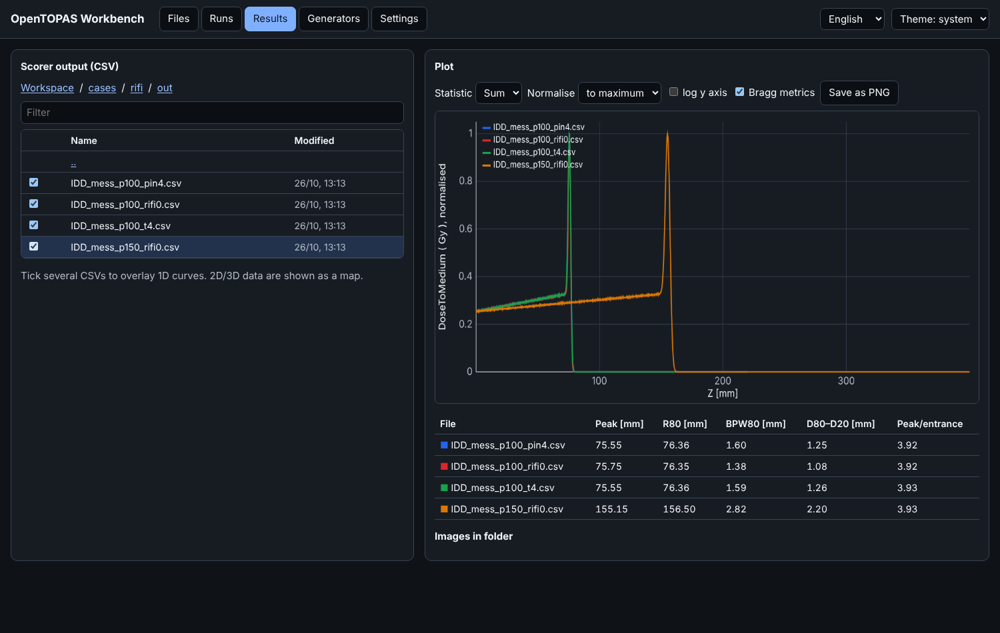
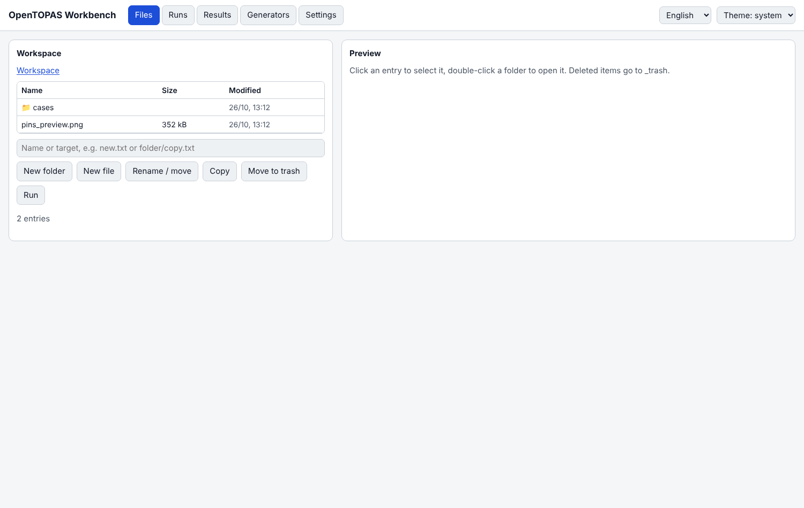
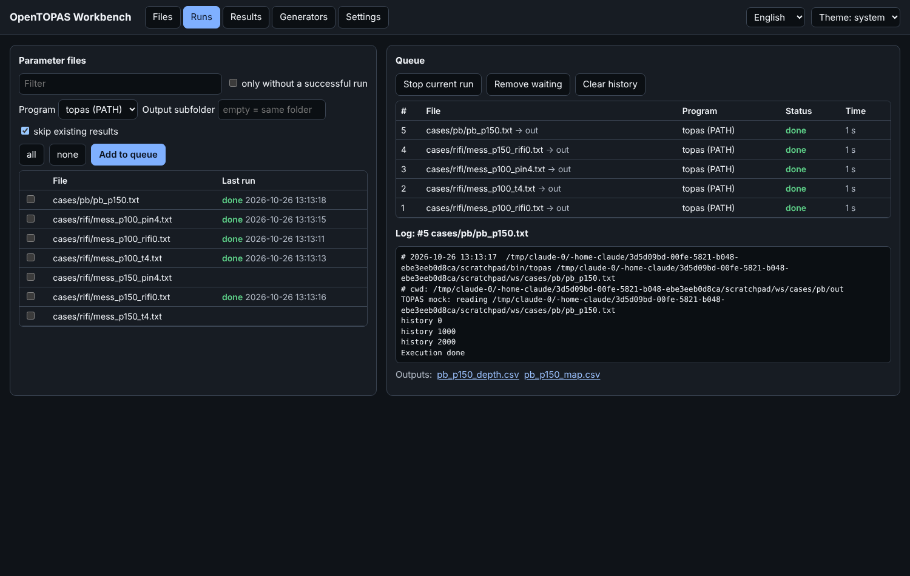
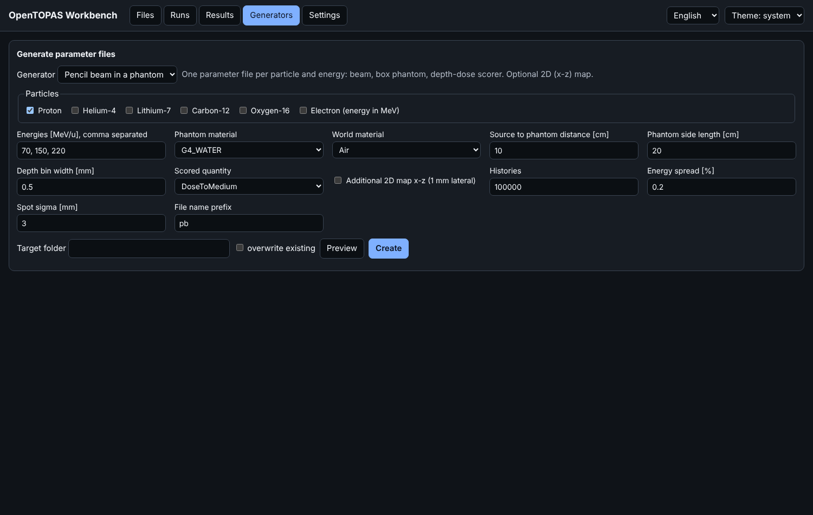

# OpenTOPAS Workbench

A local web UI for [OpenTOPAS](https://github.com/OpenTOPAS/OpenTOPAS) and TOPAS 3.9: edit parameter files, run them in a queue, and plot scorer output. Pure Python standard library, no dependencies.



> Community project, not affiliated with the TOPAS collaboration or TOPAS MC Inc.

## Features

- **Files**: browse, edit, rename, copy, and trash files in a workspace folder. The editor highlights TOPAS syntax, checks it while you type (missing type prefix, unquoted strings, missing units, vector counts, missing `includeFile` targets), and suggests parameter names.
- **Runs**: queue parameter files for one or more TOPAS installations. Progress bar with remaining time, live log with highlighted errors, stop button, optional output subfolder. Existing results are detected, also when the cases were run outside the workbench.
- **Overview**: every result in the workspace in one table, filtered by particle, energy, folder, or file-name tags. Beam data come from the parameter file that wrote the output. R80, BPW80, deviations to a reference (for example the case without filter), a Bragg-Kleeman range check, your own formula columns, CSV export, and an image gallery with full-screen view.
- **Results**: plot TOPAS CSV scorer output and measured curves (PTW `.mcc`, IBA `.asc`, column files). Overlay curves with normalisation, log axis, drag zoom, hover read-out, and difference or ratio to a reference. Bragg peak metrics (R80, BPW80, D80-D20, ΔR80, filter BPW80). 2D and 3D binnings show as a heat map.
- **Export**: plots as PNG or SVG in a print style, plotted data as CSV, results and images as ZIP. Plot settings can be saved as named views.
- **Variations**: copy a parameter file with one parameter set to a list of values; output names get a matching suffix.
- **Notifications and keep-awake**: browser or Windows notification when runs fail or the queue is done; system sleep is blocked while runs are queued.
- **Generators**: plugins that write parameter sets from a form.
  - `pencil_beam`: any particle from protons to oxygen, an energy list, phantom material, depth dose, and an optional 2D map. Sets `EMRangeMax` for light ions above the default table range.
  - `ripple_filter`: depth-dose studies with 1D, crossed, and 2D-pin ripple filters (pins written as binary STL).
- English and German UI, light and dark theme.

| Files | Runs | Generators |
|---|---|---|
|  |  |  |

## Requirements

- Python 3.8 or later
- OpenTOPAS or TOPAS 3.9 on Linux, macOS, or Windows via WSL

## Install and start

```
pip install git+https://github.com/Robing98/opentopas-workbench
opentopas-workbench --workspace PATH_TO_YOUR_CASES
```

Without installing, from a clone of this repository:

```
./workbench.sh PATH_TO_YOUR_CASES
```

On Windows with TOPAS in WSL, run `workbench.bat PATH_TO_YOUR_CASES` from a Command Prompt, or double-click it to use the current folder.

The browser opens `http://localhost:8765`. Options: `--port`, `--no-browser`.

On first start the workbench looks for TOPAS binaries in `~/.local/bin/topas4`, `~/Applications/TOPAS/OpenTOPAS-install/bin/topas`, `~/topas/topas/bin/topas`, and `topas` on `PATH`. To add or change one, open **Settings**. Environment variables such as `TOPAS_G4_DATA_DIR` go there too.

Settings, job history, and logs live in `WORKSPACE/.workbench/`.

## Writing a generator plugin

Put a Python file into `WORKSPACE/.workbench/generators/` (or into `opentopas_workbench/generators/` to ship it). It needs four names:

```python
NAME = {"en": "My study", "de": "Meine Studie"}
DESCRIPTION = {"en": "What it generates."}
FIELDS = [
    {"key": "energies", "type": "text", "label": {"en": "Energies [MeV]"}, "default": "100, 150"},
    {"key": "histories", "type": "number", "label": {"en": "Histories"}, "default": 100000},
    {"key": "material", "type": "select", "label": {"en": "Material"}, "default": "G4_WATER",
     "options": [["G4_WATER", "Water"], ["G4_PLEXIGLASS", "PMMA"]]},
]

def generate(values):
    """Return a list of (relative path, content). Content is str for text or bytes for binary files."""
    return [(f"case_{e.strip()}.txt", f"d:So/Demo/BeamEnergy = {e.strip()} MeV\n")
            for e in values["energies"].split(",")]
```

Field types: `text`, `number`, `select`, `multi` (checkboxes, value is a list), and `bool`. Labels and option names are plain strings or `{"en": ..., "de": ...}`.

## Security

The server listens on `127.0.0.1` only, rejects requests with a foreign `Host` header, requires a per-session token for every API call, and only reads or writes inside the workspace. It runs the TOPAS binaries you configure, so do not expose it to a network.

## Known limits

- Plotting reads TOPAS CSV output and measured curves. Binary and ROOT output are not plotted yet.
- The syntax check is heuristic. It checks that `includeFile` targets exist but does not merge their parameters.
- One job runs at a time. TOPAS itself uses all cores with `i:Ts/NumberOfThreads = 0`.

## Contributing

Issues and pull requests are welcome, see [CONTRIBUTING.md](CONTRIBUTING.md).

## License

MIT, see [LICENSE](LICENSE).
